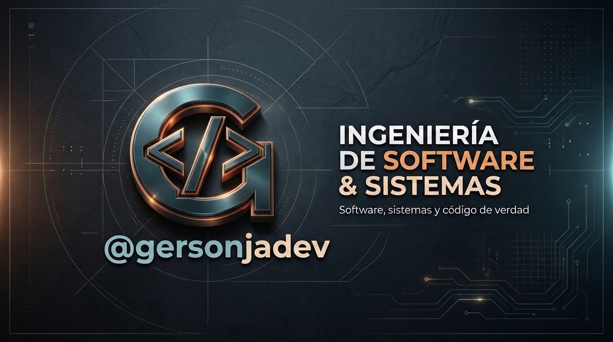

# 🦀 Curso Completo de Rust en Español
### Repositorio Oficial de Código y Ejercicios Prácticos
**Instructor:** Gerson Castellanos ([@gersonjadev](https://youtube.com/@gersonjadev)) · *Ingeniería de Software & Sistemas*

<p align="center">
  
</p>

<p align="center">
  <a href="https://youtube.com/@gersonjadev"></a>
  &nbsp;
  
  &nbsp;
  
</p>

> **Bienvenido al repositorio oficial del curso.** Aquí encontrarás el código fuente completo, probado y sin dependencias innecesarias de cada una de las clases del canal. Cada proyecto cuenta con ejemplos ejecutables, pruebas unitarias y comentarios técnicos que explican el comportamiento de la memoria (Stack vs. Heap) y el modelo de concurrencia de Rust.

---

## 🗺️ Índice de Episodios

### Fase 1: Fundamentos y Sintaxis del Sistema
| Episodio | Título | Carpeta de Código | Video |
| :---: | :--- | :---: | :---: |
| **00** | **Instala y Configura Rust como un Profesional (Windows/Linux)** | [Ver Guía](episodes/00-setup-entorno-de-desarrollo/) | [Ver Clase](https://youtube.com/@gersonjadev) |
| **01** | **Por Qué Rust y Tu Primer Proyecto con Cargo (Stack vs Heap)** | [Ver Código](episodes/01-why-rust-and-cargo/) | [Ver Clase](https://youtube.com/@gersonjadev) |
| **02** | **Inmutabilidad por Defecto y Tipos Escalares en Rust** | [Ver Código](episodes/02-inmutabilidad-y-tipos-escalares/) | [Ver Clase](https://youtube.com/@gersonjadev) |
| **03** | **Control de Flujo Expresivo en Rust: Todo es una Expresión** | [Ver Código](episodes/03-control-de-flujo-expresiones/) | [Ver Clase](https://youtube.com/@gersonjadev) |
| **04** | **Estructuras Fijas en Memoria: Tuplas, Arrays y Slices** | [Ver Código](episodes/04-tuplas-arrays-slices/) | [Ver Clase](https://youtube.com/@gersonjadev) |
| **05** | **El Poder del match en Rust: Pattern Matching Exhaustivo** | [Ver Código](episodes/05-pattern-matching-exhaustivo/) | [Ver Clase](https://youtube.com/@gersonjadev) |

*(Próximamente: Fase 2 - Memoria, Punteros y Ownership Profundo)*

---

## 🚀 Cómo Empezar

1. **Clonar este repositorio:**
   ```bash
   git clone https://github.com/gersonja/curso-rust-espanol.git
   cd curso-rust-espanol
   ```

2. **Ingresar a cualquier episodio y correr el código:**
   ```bash
   cd episodes/01-why-rust-and-cargo
   cargo run
   ```

3. **Verificar que las pruebas pasen:**
   ```bash
   cargo test
   ```

---

## 👨‍🏫 Sobre el Autor
**Gerson Castellanos** ([@gersonjadev](https://youtube.com/@gersonjadev))  
Ingeniero de Software y Arquitecto de Sistemas con más de 20 años de experiencia construyendo plataformas SaaS multitenant de alto rendimiento y software de misión crítica en producción.

* **YouTube:** [@gersonjadev](https://youtube.com/@gersonjadev)
* **GitHub:** [@gersonja](https://github.com/gersonja)
* **Contacto / Consultoría:** Consultoría técnica senior para empresas y equipos de desarrollo.

---

## 📄 Licencia
Este proyecto se distribuye bajo la licencia MIT. Eres libre de usar el código con fines educativos, personales o comerciales.
